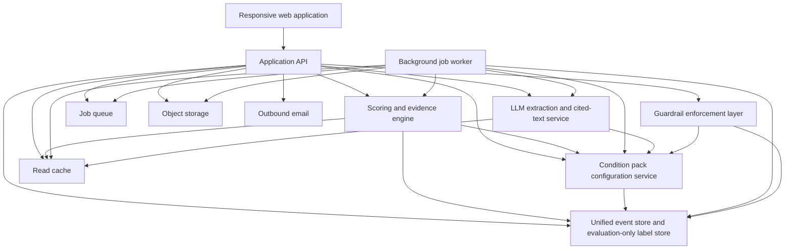
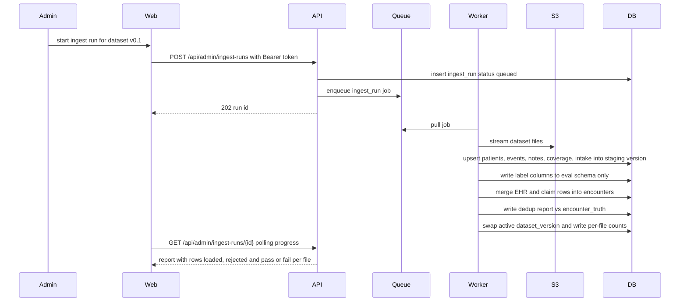
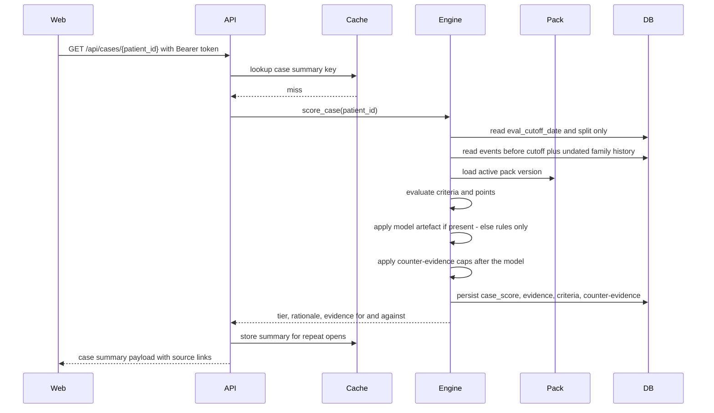
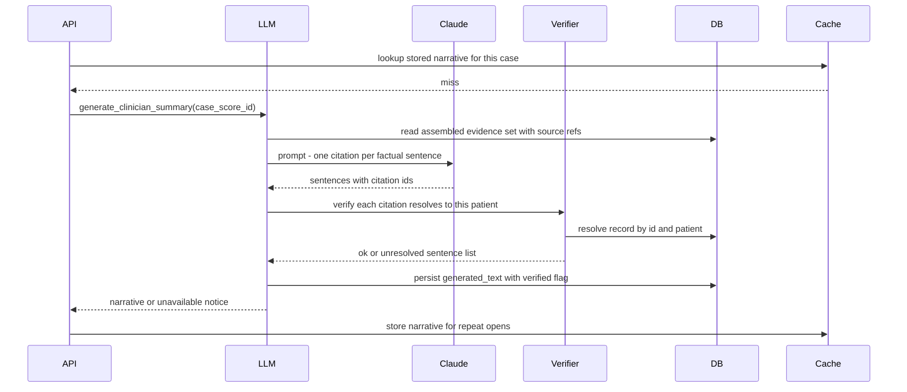
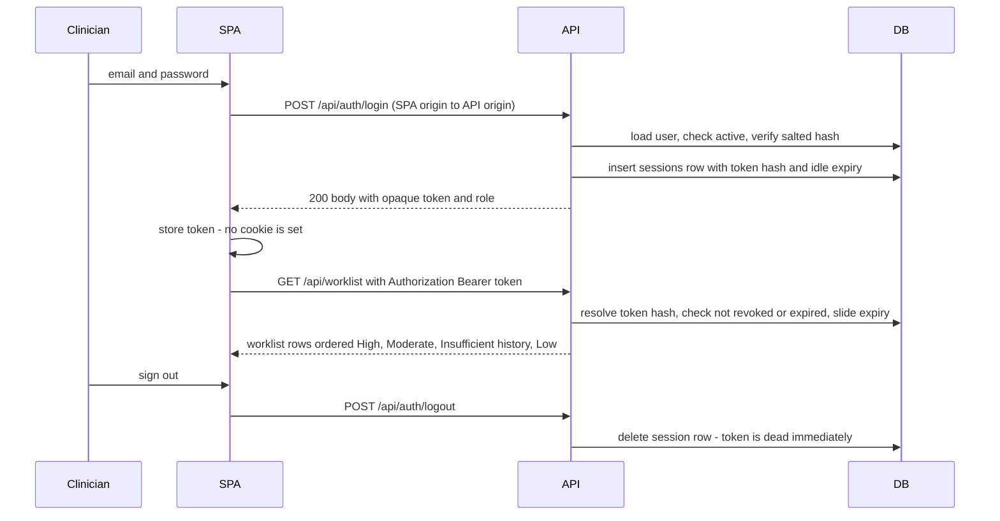
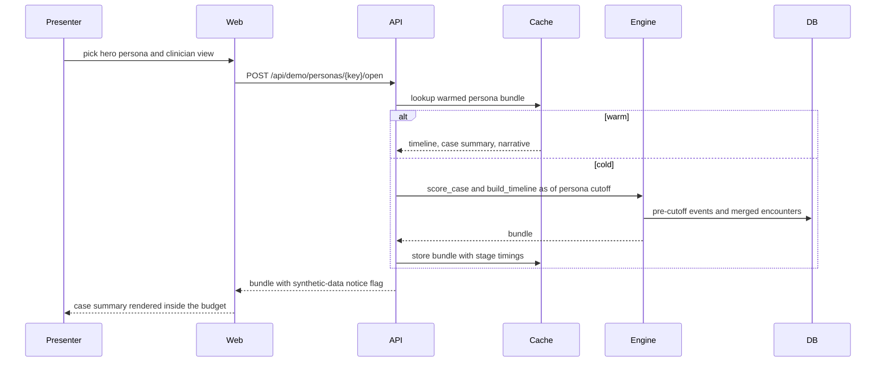
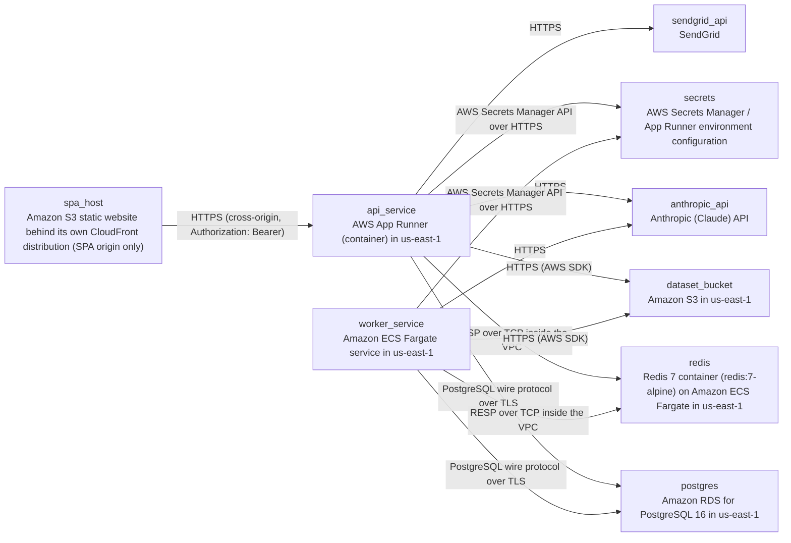

# Architecture

> Maintained by QuorQ AI SDLC. Text between `sdlc:auto` markers is regenerated; anything outside them is yours and is kept.

<!-- sdlc:auto:start narrative -->
## Overview

### ARCH-OVERVIEW · approved · source: architecture:summary

One responsive React 19 SPA calls a FastAPI 0.115 API over HTTPS from a separate origin, using opaque server-side session tokens sent as Authorization: Bearer. PostgreSQL 16 holds the synthetic dataset as a unified event model, and long-running work runs as background jobs on a Redis queue.

- Version 1, status approved.
- Clients: patient (mobile-first), clinician (desktop) and demo mode, all in the same SPA.
- Data: PostgreSQL 16 holds the loaded synthetic dataset as a unified event model with provenance on every row.
- Label separation: ground-truth labels live in a physically separate evaluation-only schema. The scoring engine's database role cannot read it.
- Background jobs on a Redis queue, with progress rows in Postgres: one-run dataset ingest (~572k events, 40k notes), encounter de-duplication against encounter_truth.csv, Anthropic-powered clue extraction, model training with threshold tuning, and the full-cohort evaluation run.
- Redis cache keeps worklists, persona case summaries and evaluation numbers warm so a hero persona opens inside the 60-second demo budget.
- Scoring is leakage-safe by construction: inputs are filtered to events before each patient's eval_cutoff_date, with undated family history excepted.
- Scoring is pack-driven: all axSpA codes, criteria, counter-evidence rules, thresholds, workup and copy live as configuration.
- Scoring output is a tier (High / Moderate / Low / Insufficient history), never a bare score. Counter-evidence caps are applied after any model contribution.
- Four guardrails run as runtime middleware and as a build-failing suite: post-cutoff block, citation verifier, patient-facing wording scan, synthetic-data banner.
- Deployment: AWS, US region. SPA on S3+CloudFront; API and worker as containers; Amazon RDS for PostgreSQL 16; a redis:7-alpine container; S3 for dataset files and generated PDFs; Anthropic and SendGrid as SaaS.

**Related:** ARCH-COMP-WEB, ARCH-COMP-API, ARCH-COMP-ENGINE, ARCH-COMP-DB, ARCH-DEPLOY

### ARCH-COMP-WEB · approved · source: architecture:component:web

Single React 19 SPA serving patient, clinician, admin and demo-mode screens. It stores the opaque session token and sends it as Authorization: Bearer on every call.

- Type: responsive web application (React 19).
- Patient screens: mobile-first intake, timeline, visit prep, share QR, post-workup update.
- Clinician screens: worklist, one-page case summary, Insufficient-history detail, decision and workup capture, evaluation report.
- Admin screens: ingest, pack configuration, settings.
- Demo mode: persona picker, odyssey replay.
- Stores the session token and sends it as Authorization: Bearer on every call.
- Renders the synthetic-data notice on every route.

**Related:** ARCH-COMP-API, ARCH-TECH-FRONTEND

### ARCH-COMP-API · approved · source: architecture:component:api

FastAPI 0.115 (Python) HTTP API. It handles authentication, sessions, invites, share links, timeline, intake, case reads, decisions, PDFs and admin/job endpoints. It enforces roles so tier, score and criteria never appear on a patient-role response.

- Authentication and server-side sessions.
- Invite and share-link issue, consume and revoke.
- Timeline assembly with source tags and gaps.
- Intake capture.
- Worklist and case summary reads.
- Decisions and workup outcomes.
- Referral-packet and visit-prep PDF generation.
- Admin ingest, pack and settings endpoints.
- Job submission and progress.
- Role enforcement keeps tier, score and criteria off every patient-role response.

**Related:** ARCH-COMP-WEB, ARCH-COMP-ENGINE, ARCH-COMP-PACK, ARCH-COMP-WORKER, ARCH-API-GROUPS

### ARCH-COMP-ENGINE · approved · source: architecture:component:engine

Python 3.12 package inside the FastAPI app that builds a leakage-safe input set per patient, evaluates criteria and points from the pack, applies the model artefact if present, then applies counter-evidence rules. It assembles evidence with resolvable source references.

- Builds each patient's leakage-safe pre-cutoff input set.
- Evaluates ASAS referral criteria and SPARTAN points from the pack.
- Applies the persisted model artefact and operating threshold when present (scikit-learn artefact loading). Falls back to rules-only when absent.
- Applies counter-evidence and demotion rules after the model contribution.
- Computes reachable history and the Insufficient-history state.
- Assembles evidence for / against / conflicting labels, each item with a resolvable source reference.

**Related:** ARCH-COMP-PACK, ARCH-COMP-GUARDRAILS, ARCH-PATH-SCORING

### ARCH-COMP-PACK · approved · source: architecture:component:pack

Condition pack configuration service (Python module, pack stored as JSONB in PostgreSQL 16). It loads, validates, versions and serves the axSpA pack as configuration data, and the app starts cleanly with no pack active.

- Pack contents: ICD-10/CPT/LOINC/local HLA-B27/ATC code lists with code-drift equivalences; signal definitions; criteria and point items; counter-evidence and demotion rules; tier and reachable-history thresholds; workup items with reasoning text; patient-facing copy; prohibited-term list.
- Records who changed what and when.
- Carries awaiting-clinical-review markers.
- The app starts cleanly with no pack active.

**Related:** ARCH-COMP-ENGINE, ARCH-COMP-API

### ARCH-COMP-WORKER · approved · source: architecture:component:worker

Python RQ workers running the same FastAPI 0.115 codebase. They consume the Redis queue and run the minutes-long jobs with progress updates.

- One-run dataset ingest (CSV, JSON, gzipped FHIR NDJSON) with per-file row counts and provenance validation.
- Encounter de-duplication and the encounter_truth check.
- LLM clue extraction over the 40k notes.
- Offline model training with val-split threshold tuning and a once-per-run test evaluation.
- Full-cohort evaluation metrics.
- Cohort guardrail sweeps.

**Related:** ARCH-COMP-QUEUE, ARCH-COMP-LLM, ARCH-PATH-INGEST, ARCH-PATH-LLM

### ARCH-COMP-LLM · approved · source: architecture:component:llm

Wraps the Anthropic (Claude) API via the anthropic Python SDK. It extracts target clues with exact quotes and generates cited narrative and visit-prep text. It degrades to structured-only output when the credential is absent or a call fails.

- Extracts the pack's target clues from notes and imaging reports. Returns a structured finding, the exact quoted sentence and the note's source_ref.
- Generates the clinician case narrative and patient visit-prep text sentence-by-sentence, with a citation on each.
- Reports connection status as connected or not configured.
- Degrades to structured-only output when the credential is absent or a call fails.

**Related:** ARCH-COMP-GUARDRAILS, ARCH-PATH-LLM

### ARCH-COMP-GUARDRAILS · approved · source: architecture:component:guardrails

Four guardrails implemented as Python middleware and a pytest suite in the FastAPI service, plus a route sweep against the React build. They run at request time and as a cohort suite that fails the build on any non-zero count.

- Post-cutoff filter applied to every scoring input and every rendered payload.
- Citation verifier blocks or flags any generated sentence whose citation does not resolve to an existing record for that patient.
- Patient-facing wording scanner over strings and responses.
- Synthetic-data banner presence check (route sweep against the React 19 build).
- Runs as request-time middleware/validators and as a cohort suite that fails the build on any non-zero count.

**Related:** ARCH-COMP-ENGINE, ARCH-COMP-LLM, ARCH-COMP-WEB

### ARCH-COMP-DB · approved · source: architecture:component:db

PostgreSQL 16 holds the unified event store and a separate evaluation-only label store. Ground truth from labels.csv sits in an eval schema reachable only by the evaluation role.

- Holds patients, ~572k provenance-bearing events, merged encounters, 40k notes and extracted findings, coverage, intake answers, condition packs, case scores and evidence, decisions, outcomes, generated texts, job and run records, and an audit log.
- The eval schema is reachable only by the evaluation role. It exposes just eval_cutoff_date and split to the app role.
- Full-text search over notes uses built-in tsvector indexes.

**Related:** ARCH-DATA-MODEL, ARCH-TECH-DATABASE

### ARCH-COMP-CACHE · approved · source: architecture:component:cache

Redis 7 (redis:7-alpine) read cache that keeps computed content warm so repeat persona opens are faster than the first and the demo stays within the 60-second budget.

- Cached: computed worklists, persona case summaries, assembled timelines, generated narrative text and the latest evaluation numbers.
- Runs on Redis db 0.

**Related:** ARCH-COMP-QUEUE, ARCH-PATH-DEMO

### ARCH-COMP-QUEUE · approved · source: architecture:component:queue

Durable Redis 7 work queue for ingest, de-duplication, extraction, training and evaluation jobs, so no screen blocks while they run.

- Runs on Redis db 1 (same instance as the cache on db 0).
- Consumed by the RQ worker.
- Progress is recorded in Postgres job_runs.

**Related:** ARCH-COMP-WORKER, ARCH-COMP-CACHE

### ARCH-COMP-S3 · approved · source: architecture:component:s3

Amazon S3 object storage for dataset files, model artefacts and generated PDFs, so large files never sit in the database or on the app container's disk.

- Uploaded dataset v0.1 files, including the gzipped bulk FHIR NDJSON.
- Persisted model artefacts.
- Generated referral-packet and visit-prep PDFs.

**Related:** ARCH-DEPLOY, ARCH-COMP-WORKER

### ARCH-COMP-EMAIL · approved · source: architecture:component:email

SendGrid outbound email. It is the only outbound mail the product sends.

- Sends tokenised invite links to patients and clinical advisors.
- Sends first-sign-in password-set links.

**Related:** ARCH-PATH-AUTH

### ARCH-PATH-INGEST · approved · source: architecture:critical_path:ingest

Admin dataset ingest with provenance validation and encounter de-duplication, run as a single transactional background job per dataset_version.

- An administrator uploads or points at the dataset v0.1 files and starts one ingest run.
- The API creates an ingest_run row and enqueues the job.
- The worker streams each file and validates required columns.
- Rows missing source_type or source_ref are rejected as provenance failures.
- Ground-truth label columns are written only into the eval schema.
- EHR and claim rows describing the same encounter are merged into one encounter, keeping both source tags. The merge is checked against encounter_truth.csv.
- The run is transactional per dataset_version: a re-run replaces the prior load rather than duplicating.
- A malformed file leaves no queryable partial rows.
- The ingest report holds per-file counts, dataset version, seed, patient count and a pass/fail line per file.

**Related:** ARCH-COMP-WORKER, ARCH-COMP-DB, ARCH-COMP-S3

### ARCH-PATH-SCORING · approved · source: architecture:critical_path:scoring

Leakage-safe scoring and tier assembly for a case. Inputs are cut off at eval_cutoff_date, and counter-evidence can only cap the tier, never raise it.

- On a case summary request, the engine loads the patient's eval_cutoff_date (the only ground-truth-adjacent field the app role may read).
- It filters the input set to events strictly before that date, plus undated family-history rows.
- It computes reachable history, then evaluates the pack's criteria and point items.
- It applies the persisted model artefact and operating threshold when one exists.
- It then applies counter-evidence and demotion rules, which can only cap the tier.
- Below the reachable-history threshold the status becomes Insufficient history.
- The result and its evidence items are persisted and cached by (patient_id, pack_version, model_run_id).

**Related:** ARCH-COMP-ENGINE, ARCH-COMP-PACK, ARCH-COMP-CACHE, ARCH-COMP-GUARDRAILS

### ARCH-PATH-LLM · approved · source: architecture:critical_path:llm_extraction

LLM clue extraction runs as a cohort job. Cited summary generation runs on demand and is checked by the citation verifier. The case still renders without generated text if the credential is missing or a call fails.

- Extraction: the worker batches notes and asks Claude for the pack's target clues.
- Each finding must carry the exact quoted sentence plus the note's source_ref.
- Findings are stored. Notes with no target clue are recorded as processed with zero findings.
- The worker writes the extraction report with its templated-note caveat.
- Summary generation: on demand from the assembled evidence set, with a citation on each generated sentence.
- The verifier resolves every citation against a record belonging to that patient. Any unresolvable sentence is blocked or visibly flagged.
- If the credential is missing or a call fails, the case still renders tier, evidence and criteria. The narrative section states that generated text is unavailable.

**Related:** ARCH-COMP-LLM, ARCH-COMP-WORKER, ARCH-COMP-GUARDRAILS

### ARCH-PATH-AUTH · approved · source: architecture:critical_path:auth

Clinician sign-in and cross-origin session handling using opaque server-side tokens sent as Authorization: Bearer. All revocation is server-side.

- The clinician posts email and password to the API from the SPA origin.
- The API verifies the salted hash and refuses deactivated accounts.
- It creates a sessions row holding only a hash of a high-entropy opaque token with an idle expiry. The token is returned in the response body.
- The SPA stores the token and sends Authorization: Bearer on every subsequent call.
- Each request slides the idle expiry.
- Sign-out, idle expiry and administrator deactivation all revoke server-side, so no further request with that token succeeds.
- Invite and share tokens follow the same shape: hashed at rest, single-use or revocable, scoped to one patient and one role.

**Related:** ARCH-COMP-API, ARCH-COMP-WEB, ARCH-COMP-EMAIL

### ARCH-PATH-DEMO · approved · source: architecture:critical_path:demo_persona

Demo persona open inside the 60-second budget, served from cache when warm and computed and cached when cold. A warm-up job primes all six personas after ingest.

- The presenter picks one of the six heroes.json personas and chooses the patient or clinician view.
- The API resolves the persona to its patient and cutoff date.
- The timeline and case summary are served from cache when warm, or computed and cached when cold.
- A warm-up job primes all six personas after ingest, so the first live open is already warm.
- The performance check times each stage (timeline assembly, scoring, evidence assembly, narrative). It names the slow stage if any persona exceeds the budget.

**Related:** ARCH-COMP-CACHE, ARCH-COMP-WORKER, ARCH-PATH-SCORING

### ARCH-TECH-FRONTEND · approved · source: architecture:technology_decision:frontend

Frontend: React 19, chosen over Vue 3, SvelteKit and Angular. One codebase serves both the mobile-first patient flow and the dense desktop clinician views.

- Alternatives considered: Vue 3, SvelteKit, Angular.
- Rationale: one codebase carries the one-question-per-screen intake and timeline (mobile-first) and the clinician worklist and one-page case summary (desktop).
- Routes are split by role, so patient screens are compiled from serialisers that never receive a tier.
- Demo pieces (persona picker, odyssey replay animation, evidence chips that drill into the timeline, QR share) are ordinary React components.
- The build reads the API hostname from VITE_API_BASE_URL.
- The opaque session token is kept in memory/storage and sent as Authorization: Bearer.

**Related:** ARCH-COMP-WEB

### ARCH-TECH-BACKEND · approved · source: architecture:technology_decision:backend

Backend: FastAPI 0.115, chosen over Django REST Framework, Flask and Node.js with NestJS. The existing Python scoring engine moves in as modules, and the API and worker share one image.

- Alternatives considered: Django REST Framework, Flask, Node.js with NestJS.
- Rationale: the scoring engine, leakage-safe cutoff logic and evaluation metrics already exist in Python, so they move in as modules rather than being re-implemented and re-validated.
- The same image runs the API and the RQ worker, so ingest, de-duplication, extraction, training and evaluation share the exact engine code the live case path uses.
- Pydantic response models are where the role split and guardrails are enforced, giving one place to prove no tier or score leaves on a patient-role response.

**Related:** ARCH-COMP-API, ARCH-COMP-ENGINE, ARCH-COMP-WORKER

### ARCH-TECH-DATABASE · approved · source: architecture:technology_decision:database

Database: PostgreSQL 16, chosen over MySQL 8, MongoDB and SQLite. It suits the relational, provenance-per-row event model and provides schema-level grants that keep ground-truth labels from the engine role.

- Alternatives considered: MySQL 8, MongoDB, SQLite.
- The unified event model is one row per fact per source with provenance on every row, which suits a relational table.
- Every flag links back to its source record through a join from evidence_items to events or note_findings.
- Holds 572k events, 167k truth rows and 40k notes, indexed by patient and event_time so a persona renders inside the 60-second budget.
- Built-in full-text search covers finding wording in notes with no separate search service.
- JSONB holds the condition pack and metric payloads.
- Schema-level grants physically keep the ground-truth labels away from the engine role.

**Related:** ARCH-COMP-DB, ARCH-DATA-MODEL

### ARCH-TECH-CLOUD · approved · source: architecture:technology_decision:cloud

Cloud: AWS in a US region, chosen over GCP, Azure and Render. It is a standard managed web-app environment with a clear path to the deferred HIPAA-eligible configuration and SOC 2 work.

- Alternatives considered: Google Cloud Platform, Microsoft Azure, Render.
- Services: App Runner for the FastAPI service, ECS Fargate for the RQ worker and the redis:7-alpine container, Amazon RDS for PostgreSQL 16, S3 for dataset files and PDFs, Secrets Manager for credentials.
- Rationale: the environment clinical advisors and investors expect to hear named.
- It has the clearest path to the HIPAA-eligible configuration and SOC 2 work that is deliberately deferred, so the PoC does not need rebuilding when real patient data arrives.

**Related:** ARCH-DEPLOY

### ARCH-DATA-IDENTITY · approved · source: architecture:entities:identity_access

Entities for accounts, sessions, invites, share links and audit.

- users: id, email, password_hash, role, patient_id, is_active, must_set_password, created_at, deactivated_at
- sessions: id, user_id, token_hash, created_at, last_seen_at, idle_expires_at, revoked_at
- invites: id, token_hash, patient_id, issued_by_user_id, granted_role, status, expires_at, opened_at, consumed_at, intake_completed_at
- share_links: id, token_hash, patient_id, created_by_user_id, expires_at, revoked_at
- audit_log: id, actor_user_id, action, patient_id, detail, occurred_at

**Related:** ARCH-DATA-MODEL, ARCH-PATH-AUTH

### ARCH-DATA-MODEL · approved · source: architecture:entities:dataset

Entities for the unified event store and the evaluation-only label store. Provenance (source_type, source_ref) is on event rows, and ground truth is isolated in eval-schema tables.

- patients: id, dataset_patient_id, dataset_version, display_name, birth_year, sex, reachable_history_start, assigned_clinician_id
- events: id, patient_id, source_event_id, event_time, event_type, code_system, code, display, value, unit, provider_org, provider_specialty, source_type, source_ref, encounter_ref, encounter_id, confidence, dataset_version
- encounters: id, patient_id, encounter_time, provider_org, source_types, merged_row_count, dataset_version
- notes: id, patient_id, source_ref, note_time, note_type, text, text_tsv, processed_at
- note_findings: id, note_id, patient_id, clue_type, finding_value, quoted_sentence, source_ref, extractor_model, extracted_at
- coverage_periods: id, patient_id, payer, start_date, end_date, gap_reason
- intake_answers: id, patient_id, question_key, answer_value, answered_at, event_id, is_complete
- eval_labels (eval schema): patient_id, eval_cutoff_date, split, archetype, typicality, clue_density, hla_b27_true, axspa_label, simulated_diagnosis_date
- encounter_truth: id, patient_id, true_encounter_id, encounter_time, visible_in_sources, matched_encounter_id

**Related:** ARCH-COMP-DB, ARCH-PATH-INGEST, ARCH-DATA-IDENTITY

### ARCH-DATA-CLINICAL · approved · source: architecture:entities:scoring_clinical

Entities for packs, scores, evidence, criteria, counter-evidence, workup, decisions and generated text.

- condition_packs: id, pack_key, version, enabled, config, awaiting_review, updated_by, updated_at
- pack_change_log: id, pack_id, changed_by, changed_at, change_summary
- case_scores: id, patient_id, pack_version, model_run_id, tier, one_line_reason, cutoff_date, reachable_history_months, scored_without_model, spartan_points, prior_tier, scored_at
- evidence_items: id, case_score_id, direction, label, event_id, note_finding_id, item_date, source_tag, rank
- criteria_results: id, case_score_id, criterion_key, criterion_set, status, points, supporting_evidence_id, what_would_answer_it
- counter_evidence_hits: id, case_score_id, rule_key, plain_language, alternative_explanation, tier_cap, awaiting_clinical_review
- workup_suggestions: id, case_score_id, item_key, patient_specific_reason, already_done, done_date, done_result
- workup_outcomes: id, patient_id, recorded_by, recorded_at, results, resulting_tier, patient_update_text
- decisions: id, patient_id, case_score_id, clinician_id, decision, reason, tier_at_time, created_at, superseded_by
- generated_texts: id, patient_id, case_score_id, kind, sentences, all_citations_resolved, model_name, generated_at

**Related:** ARCH-DATA-MODEL, ARCH-COMP-ENGINE, ARCH-COMP-PACK

### ARCH-DATA-OPS · approved · source: architecture:entities:runs_jobs_personas

Entities for model runs, evaluation runs, ingest runs, job progress and demo personas.

- model_runs: id, dataset_version, seed, feature_list, artefact_s3_key, operating_threshold, threshold_objective, val_metrics, test_metrics, test_evaluations_count, is_active, created_at
- evaluation_runs: id, split, model_run_id, pack_version, dataset_version, reachable_history_threshold, metrics, run_date
- ingest_runs: id, dataset_version, seed, status, patient_count, dedup_report, started_at, finished_at
- ingest_file_results: id, ingest_run_id, file_name, rows_loaded, rows_rejected, status, error_detail
- job_runs: id, kind, status, progress_pct, progress_message, result, started_at, finished_at
- personas: id, persona_key, name, one_line_description, patient_id, expected_outcome

**Related:** ARCH-DATA-MODEL, ARCH-COMP-WORKER

### ARCH-API-GROUPS · approved · source: architecture:endpoints:auth_invites_patient

Authentication, invite and patient-role endpoints. Patient-role responses never contain tier, score or condition name.

- POST /api/auth/login: clinician or patient signs in with email and password; refuses deactivated accounts.
- POST /api/auth/logout: revokes the current session server-side so the token stops working immediately.
- GET /api/auth/me: current user, role and session idle expiry.
- POST /api/auth/set-password: sets the password at first sign-in (<set-at-first-login>) or after a reset link.
- POST /api/invites: clinician issues a single-use tokenised invite for one patient, optionally emailed via SendGrid.
- GET /api/invites/{token}: validates an invite link without revealing patient data; marks it opened.
- POST /api/invites/{token}/accept: consumes the invite and returns a patient-role session token scoped to exactly one patient.
- GET /api/patients/me/timeline: merged chronological story with source tags, coverage gaps and the reachable-history banner; no tier, score or condition name.
- GET /api/patients/me/intake: pack's intake questions, next unanswered question and progress position.
- POST /api/patients/me/intake/answers: saves one answer as a patient-sourced event tagged You told us.
- GET /api/patients/me/visit-prep: plain-language visit-prep sheet with cited patterns and suggested questions, screened by the patient-copy guardrail.
- GET /api/patients/me/visit-prep.pdf: printable visit-prep document with the synthetic-data notice on every page.
- GET /api/patients/me/updates: post-workup plain-language update naming the tests done and the clinician's suggested next step; no tier, score or diagnosis.
- POST /api/patients/me/share-links: creates an unguessable share link, returned with the data the SPA renders as a QR code.
- GET /api/patients/me/share-links: lists the patient's active share links.
- DELETE /api/patients/me/share-links/{share_id}: revokes a share link immediately.
- GET /api/shared/{token}: resolves a share token to its patient case for a signed-in clinician and records the access against the case.

**Related:** ARCH-COMP-API, ARCH-PATH-AUTH

### ARCH-API-CLINICIAN · approved · source: architecture:endpoints:clinician_demo_evaluation

Clinician, demo and evaluation endpoints for the worklist, case summary, timeline drill-through, rescore, decisions, workup outcomes, referral PDF, personas and evaluation runs.

- GET /api/worklist: assigned patients with status, one-line reason, reachable history span, invite status and latest decision, ordered High, Moderate, Insufficient history, Low.
- GET /api/cases/{patient_id}: one-page case summary with status and rationale, top evidence, evidence against, conflicting labels, criteria met/missing/unknown, counter-evidence with named alternative, suggested workup, narrative or an unavailable notice, and the Insufficient-history detail block when it applies.
- GET /api/cases/{patient_id}/timeline: full clinician timeline positioned at a given evidence item; post-cutoff items are never returned.
- POST /api/cases/{patient_id}/rescore: recomputes against the active pack and model artefact, invalidating the cache.
- POST /api/cases/{patient_id}/decisions: records agree, disagree or need more info with reason, clinician identity, timestamp and tier shown; supersedes any prior decision while keeping history.
- POST /api/cases/{patient_id}/workup-outcomes: records results with date and recording clinician, lowers the tier per pack rules, keeps the prior tier in history and prepares the patient update.
- GET /api/cases/{patient_id}/referral-packet.pdf: printable referral packet with status, evidence for and against, conflicting labels, criteria, workup reasoning and timeline extract, each item dated and source-tagged; synthetic-data notice on every page; nothing dated on or after the cutoff.
- GET /api/demo/personas: lists the six hero personas with name and one-line description.
- POST /api/demo/personas/{persona_key}/open: loads the persona's timeline, intake answers and case as of its cutoff, from cache when warm, with stage timings for the performance check.
- GET /api/demo/personas/{persona_key}/replay: odyssey replay tracks (real journey vs first point the engine would have reached High or Moderate, lead time, facts nobody connected with sources); for an Insufficient-history persona it returns that point and what was missing.
- POST /api/evaluation/runs: queues an evaluation run over a selected split using the active model artefact and threshold.
- GET /api/evaluation/runs/latest: latest metrics with each value beside its PRD target and a pass or fail marker, plus split, dataset version, threshold, run date, synthetic-data notice and templated-notes caveat; refused to any other role.

**Related:** ARCH-COMP-API, ARCH-PATH-SCORING, ARCH-PATH-DEMO

### ARCH-API-ADMIN · approved · source: architecture:endpoints:admin_health

Admin and health endpoints for ingest, jobs, extraction report, pack management, user deactivation, settings and health.

- POST /api/admin/ingest-runs: starts one ingest run over the configured dataset location, replacing any prior load of that dataset version.
- GET /api/admin/ingest-runs/{run_id}: ingest report with dataset version, seed, total patient count, per-file rows loaded and rejected with pass or fail, named failures with file and column, provenance failures and the de-duplication report.
- POST /api/admin/jobs: queues a background job of kind dedup_check, extraction, training or warm_personas.
- GET /api/admin/jobs/{job_id}: job status, progress percentage and message.
- GET /api/admin/extraction-report: notes processed, findings per clue type and the caveat that templated note text makes extraction easier than real clinical text.
- GET /api/admin/pack: active condition pack with awaiting-clinical-review markers, or a report that no pack is active.
- PUT /api/admin/pack: saves an edited pack as a new version, recording who changed it and when; applies at the next rescore with no deployment.
- POST /api/admin/users/{user_id}/deactivate: deactivates an account and revokes all its sessions.
- GET /api/admin/settings: running environment, health check result, active dataset version, active pack version and model run, and credential status shown as a masked placeholder with connected or not configured.
- GET /health: liveness and readiness including database, cache and queue reachability.

**Related:** ARCH-COMP-API, ARCH-COMP-WORKER, ARCH-COMP-PACK

### ARCH-DEPLOY · approved · source: architecture:deployment_nodes

All nodes deploy on AWS us-east-1. The SPA is on S3 behind CloudFront. The API runs on App Runner, the worker and Redis on ECS Fargate, the database on RDS PostgreSQL 16, and Anthropic and SendGrid are consumed as SaaS.

- spa_host: Amazon S3 static website behind its own CloudFront distribution (SPA origin only); React 19 production build; VITE_API_BASE_URL injected at build/deploy.
- api_service: AWS App Runner (container) in us-east-1; FastAPI 0.115 on Python 3.12 behind Uvicorn; own HTTPS hostname separate from the SPA.
- worker_service: Amazon ECS Fargate service in us-east-1; same FastAPI 0.115 image run as an RQ worker for ingest, dedup, extraction, training and evaluation.
- postgres: Amazon RDS for PostgreSQL 16 in us-east-1; app schema plus eval schema with a separate role; encrypted at rest with KMS; automated backups.
- redis: Redis 7 container (redis:7-alpine) on Amazon ECS Fargate in us-east-1; one instance serving the cache on db 0 and the job queue on db 1; reachable only inside the VPC.
- dataset_bucket: Amazon S3 in us-east-1; private bucket for dataset v0.1 files including fhir/*.ndjson.gz, model artefacts and generated PDFs; SSE-KMS encryption, versioning on, public access blocked.
- anthropic_api: Anthropic (Claude) API, SaaS over HTTPS; credential supplied as ANTHROPIC_API_KEY.
- sendgrid_api: SendGrid, SaaS over HTTPS; credential supplied as SENDGRID_API_KEY.
- secrets: AWS Secrets Manager / App Runner environment configuration; holds <database-connection-string>, <anthropic-api-key>, <sendgrid-api-key> and the S3 credentials, injected as environment variables at start.

**Related:** ARCH-TECH-CLOUD, ARCH-COMP-S3, ARCH-COMP-CACHE, ARCH-COMP-DB
<!-- sdlc:auto:end narrative -->

<!-- sdlc:auto:start building-blocks -->
## Building Block View

| ID | Name | Technology | Responsibility | Depends on |
|---|---|---|---|---|
| web | Responsive web application | React 19 | Single React 19 SPA serving patient screens (mobile-first intake, timeline, visit prep, share QR, post-workup update), clinician screens (worklist, one-page case summary, Insufficient-history detail, decision and workup capture, evaluation report), admin screens (ingest, pack configuration, settings) and demo mode (persona picker, odyssey replay). Stores the opaque session token and sends it as Authorization: Bearer on every call. Renders the synthetic-data notice on every route. | api |
| api | Application API | FastAPI 0.115 (Python) | FastAPI 0.115 HTTP API: authentication and server-side sessions, invite and share-link issue/consume/revoke, timeline assembly with source tags and gaps, intake capture, worklist and case summary reads, decisions and workup outcomes, referral-packet and visit-prep PDF generation, admin ingest/pack/settings endpoints, job submission and progress, and role enforcement that keeps tier, score and criteria off every patient-role response. | db, cache, queue, engine, pack, llm, s3, email, guardrails |
| engine | Scoring and evidence engine | Python 3.12 module in the FastAPI 0.115 service (scikit-learn artefact loading) | Python package inside the FastAPI app: builds each patient's leakage-safe pre-cutoff input set, evaluates ASAS referral criteria and SPARTAN points from the pack, applies the persisted model artefact and operating threshold when present (rules-only fallback when absent), applies counter-evidence and demotion rules after the model contribution, computes reachable history and the Insufficient-history state, and assembles evidence for / against / conflicting labels with a resolvable source reference on every item. | db, pack, cache |
| pack | Condition pack configuration service | Python module in FastAPI 0.115, pack stored as JSONB in PostgreSQL 16 | Loads, validates, versions and serves the axSpA pack as configuration data — ICD-10/CPT/LOINC/local HLA-B27/ATC code lists with code-drift equivalences, signal definitions, criteria and point items, counter-evidence and demotion rules, tier and reachable-history thresholds, workup items with reasoning text, patient-facing copy and the prohibited-term list. Records who changed what and when, carries awaiting-clinical-review markers, and lets the app start cleanly with no pack active. | db |
| worker | Background job worker | Python RQ workers running the same FastAPI 0.115 codebase | Consumes the Redis queue and runs the minutes-long work with progress updates: the one-run dataset ingest (CSV, JSON, gzipped FHIR NDJSON) with per-file row counts and provenance validation, encounter de-duplication and the encounter_truth check, LLM clue extraction over the 40k notes, offline model training with val-split threshold tuning and a once-per-run test evaluation, full-cohort evaluation metrics, and cohort guardrail sweeps. | db, queue, cache, s3, llm, engine, pack |
| llm | LLM extraction and cited-text service | Anthropic (Claude) SaaS accessed from the FastAPI 0.115 service via the anthropic Python SDK | Wraps the Anthropic (Claude) API: extracts the pack's target clues from notes and imaging reports returning a structured finding plus the exact quoted sentence and the note's source_ref, and generates the clinician case narrative and patient visit-prep text sentence-by-sentence with a citation on each. Reports connection status as connected or not configured and degrades to structured-only output when the credential is absent or a call fails. | pack, cache |
| guardrails | Guardrail enforcement layer | Python middleware and pytest suite in the FastAPI 0.115 service, plus a route sweep against the React 19 build | The four shipped guardrails as code: a post-cutoff filter applied to every scoring input and every rendered payload, the citation verifier that blocks or flags any generated sentence whose citation does not resolve to an existing record for that patient, the patient-facing wording scanner over strings and responses, and the synthetic-data banner presence check. Runs as request-time middleware/validators and as a cohort suite that fails the build on any non-zero count. | db, pack |
| db | Unified event store and evaluation-only label store | PostgreSQL 16 | PostgreSQL 16 holding patients, ~572k provenance-bearing events, merged encounters, 40k notes and extracted findings, coverage, intake answers, condition packs, case scores and evidence, decisions, outcomes, generated texts, job and run records, and an audit log. Ground truth from labels.csv lives in a separate eval schema reachable only by the evaluation role, which exposes just eval_cutoff_date and split to the app role. Full-text search over notes uses built-in tsvector indexes. | — |
| cache | Read cache | Redis 7 (redis:7-alpine) | Keeps computed worklists, persona case summaries, assembled timelines, generated narrative text and the latest evaluation numbers warm so a repeat persona open is faster than the first and the demo stays inside the 60-second budget. | — |
| queue | Job queue | Redis 7 as a queue (redis:7-alpine) | Durable work queue for ingest, de-duplication, extraction, training and evaluation jobs so no screen blocks while they run. | — |
| s3 | Object storage | Amazon S3 | Holds the uploaded dataset v0.1 files including the gzipped bulk FHIR NDJSON, persisted model artefacts, and generated referral-packet and visit-prep PDFs, so large files never sit in the database or on the app container's disk. | — |
| email | Outbound email | SendGrid | Sends tokenised invite links to patients and clinical advisors and first-sign-in password-set links. The only outbound mail the product sends. | — |

<!-- sdlc:auto:end building-blocks -->

<!-- sdlc:auto:start runtime -->
## Runtime View

### Admin dataset ingest with provenance validation and encounter de-duplication

An administrator uploads or points at the dataset v0.1 files and starts one ingest run. The API creates an ingest_run row and enqueues the job. The worker streams each file, validates required columns, rejects rows missing source_type or source_ref as provenance failures, writes ground-truth label columns only into the eval schema, merges EHR and claim rows describing the same encounter into one merged encounter keeping both source tags, and checks the merge against encounter_truth.csv. The run is transactional per dataset_version: a re-run replaces the prior load rather than duplicating, and a malformed file leaves no queryable partial rows. Per-file counts, the dataset version, the seed, the patient count and a pass/fail line per file land in the ingest report.

- **Components:** web, api, worker, s3, db, queue, guardrails
- **Modules:** api/routers/admin_ingest.py, worker/jobs/ingest_run.py, worker/ingest/readers.py (csv, json, gzip ndjson), worker/ingest/provenance.py, worker/ingest/encounter_dedup.py, worker/ingest/label_quarantine.py, db/migrations
- **Key functions:** start_ingest_run(dataset_version, seed, source_uri) -> IngestRun, read_events_csv(path, chunk_size) -> Iterator[EventRow], validate_provenance(row) -> ProvenanceResult, load_fhir_ndjson_gz(path, resource_type) -> Iterator[EventRow], quarantine_labels(rows) -> None  # writes eval schema only, merge_encounters(patient_id) -> list[MergedEncounter], check_against_encounter_truth(dataset_version) -> DedupReport, finalise_run(run_id) -> IngestReport

### Leakage-safe scoring and tier assembly for a case

When a case summary is requested, the engine loads the patient's eval_cutoff_date (the only ground-truth-adjacent field the app role may read), filters the input set to events strictly before that date plus undated family-history rows, computes reachable history, evaluates the pack's criteria and point items, applies the persisted model artefact and operating threshold when one exists, then applies counter-evidence and demotion rules which can only cap the tier, never raise it. Below the reachable-history threshold the status becomes Insufficient history. The result and its evidence items are persisted and cached by (patient_id, pack_version, model_run_id).

- **Components:** api, engine, pack, db, cache, guardrails
- **Modules:** engine/input_set.py, engine/criteria.py, engine/model_scorer.py, engine/counter_evidence.py, engine/tiering.py, engine/evidence_assembly.py, guardrails/post_cutoff.py
- **Key functions:** build_input_set(patient_id, cutoff_date) -> InputSet, assert_no_post_cutoff(input_set, cutoff_date) -> None, evaluate_criteria(input_set, pack) -> CriteriaResult, apply_model(input_set, artefact, threshold) -> ModelResult \| None, apply_counter_evidence(tier, input_set, pack) -> TierCap, assign_tier(criteria, model_result, caps, reachable_months, pack) -> Tier, assemble_evidence(input_set, criteria, caps) -> list[EvidenceItem], persist_case_score(patient_id, tier, evidence, criteria) -> CaseScore

### LLM clue extraction and cited summary generation with the citation verifier

Extraction runs as a cohort job: the worker batches notes, asks Claude for the pack's target clues and requires the exact quoted sentence plus the note's source_ref, stores findings (and records notes with no target clue as processed with zero findings), and writes the extraction report with its templated-note caveat. Summary generation runs on demand from the assembled evidence set: each generated sentence carries a citation, the verifier resolves every citation against a record belonging to that patient, and any unresolvable sentence is blocked or visibly flagged. If the credential is missing or a call fails, the case still renders tier, evidence and criteria with the narrative section stating that generated text is unavailable.

- **Components:** worker, llm, api, db, cache, guardrails, pack
- **Modules:** worker/jobs/extract_clues.py, llm/anthropic_client.py, llm/extraction_prompts.py, llm/summary_generator.py, guardrails/citation_verifier.py, guardrails/patient_copy_scan.py
- **Key functions:** extract_clues(note_batch, pack_clues) -> list[NoteFinding], store_finding(note_id, clue_type, quoted_sentence, source_ref) -> NoteFinding, generate_clinician_summary(case_score_id) -> GeneratedText, generate_visit_prep(patient_id) -> GeneratedText, verify_citations(generated_text, patient_id) -> VerificationResult, scan_patient_copy(strings, prohibited_terms) -> list[Violation]

### Clinician sign-in and cross-origin session handling

The clinician posts email and password to the API from the SPA origin. The API verifies the salted hash, refuses deactivated accounts, creates a sessions row holding only a hash of a high-entropy opaque token with an idle expiry, and returns the token in the response body. The SPA stores it and sends Authorization: Bearer on every subsequent call. Each request slides the idle expiry. Sign-out, idle expiry and administrator deactivation all revoke server-side so no further request with that token succeeds. Invite and share tokens follow the same shape: hashed at rest, single-use or revocable, scoped to one patient and one role.

- **Components:** web, api, db, guardrails
- **Modules:** api/routers/auth.py, api/security/sessions.py, api/security/passwords.py, api/security/invites.py, api/deps/current_user.py
- **Key functions:** login(email, password) -> SessionToken, create_session(user_id, idle_minutes) -> tuple[token, Session], resolve_bearer(token) -> CurrentUser \| None, logout(token) -> None, deactivate_user(user_id) -> int  # revokes all sessions, issue_invite(patient_id, issued_by, expiry) -> InviteLink, consume_invite(token) -> SessionToken  # patient role, one patient

### Demo persona open inside the sixty-second budget

The presenter picks one of the six heroes.json personas and chooses the patient or clinician view. The API resolves the persona to its patient and cutoff date, then serves the timeline and case summary from cache when warm or computes and caches them when cold. A warm-up job primes all six personas after ingest so the first live open is already warm, and the performance check times each stage (timeline assembly, scoring, evidence assembly, narrative) and names the slow stage if any persona exceeds the budget.

- **Components:** web, api, engine, cache, db, worker, guardrails
- **Modules:** api/routers/demo.py, api/services/timeline.py, worker/jobs/warm_personas.py, tests/performance/persona_budget.py
- **Key functions:** list_personas() -> list[Persona], open_persona(persona_key, view) -> PersonaBundle, build_timeline(patient_id, cutoff_date) -> Timeline, warm_persona_cache(persona_keys) -> None, measure_stages(persona_key) -> StageTimings, build_replay(persona_key) -> ReplayTracks

<!-- sdlc:auto:end runtime -->

<!-- sdlc:auto:start deployment-view -->
## Deployment View

| Name | Service | Runtime | Scaling | Environment |
|---|---|---|---|---|
| spa_host | Amazon S3 static website behind its own CloudFront distribution (SPA origin only) | React 19 production build, VITE_API_BASE_URL injected at build/deploy | CDN edge, no instance scaling | dev |
| api_service | AWS App Runner (container) in us-east-1 | FastAPI 0.115 on Python 3.12 behind Uvicorn, own HTTPS hostname separate from the SPA | 1 instance for the PoC, autoscale 1-2 | dev |
| worker_service | Amazon ECS Fargate service in us-east-1 | Same FastAPI 0.115 image run as an RQ worker for ingest, dedup, extraction, training and evaluation | 1 task, scaled manually for the ingest run | dev |
| postgres | Amazon RDS for PostgreSQL 16 in us-east-1 | PostgreSQL 16, app schema plus eval schema with a separate role, encrypted at rest with KMS, automated backups | Single-AZ db.t4g.medium with gp3 storage sized for ~572k events, 167k truth rows and 40k notes | dev |
| redis | Redis 7 container (redis:7-alpine) on Amazon ECS Fargate in us-east-1 | One Redis 7 instance serving the cache on db 0 and the job queue on db 1, reachable only inside the VPC | Single task | dev |
| dataset_bucket | Amazon S3 in us-east-1 | Private bucket for dataset v0.1 files including fhir/*.ndjson.gz, model artefacts and generated PDFs, SSE-KMS encryption, versioning on, public access blocked | Managed | dev |
| anthropic_api | Anthropic (Claude) API | SaaS over HTTPS, credential supplied as ANTHROPIC_API_KEY | Managed by provider | dev |
| sendgrid_api | SendGrid | SaaS over HTTPS, credential supplied as SENDGRID_API_KEY | Managed by provider | dev |
| secrets | AWS Secrets Manager / App Runner environment configuration | Holds <database-connection-string>, <anthropic-api-key>, <sendgrid-api-key> and the S3 credentials, injected as environment variables at start | Managed | dev |

| Source | Target | Protocol |
|---|---|---|
| spa_host | api_service | HTTPS (cross-origin, Authorization: Bearer) |
| api_service | postgres | PostgreSQL wire protocol over TLS |
| api_service | redis | RESP over TCP inside the VPC |
| api_service | dataset_bucket | HTTPS (AWS SDK) |
| api_service | anthropic_api | HTTPS |
| api_service | sendgrid_api | HTTPS |
| worker_service | redis | RESP over TCP inside the VPC |
| worker_service | postgres | PostgreSQL wire protocol over TLS |
| worker_service | dataset_bucket | HTTPS (AWS SDK) |
| worker_service | anthropic_api | HTTPS |
| api_service | secrets | AWS Secrets Manager API over HTTPS |
| worker_service | secrets | AWS Secrets Manager API over HTTPS |

<!-- sdlc:auto:end deployment-view -->

<!-- sdlc:auto:start decisions -->
## Architecture Decisions

| Layer | Choice | ADR |
|---|---|---|
| Frontend | React 19 | [ADR-0001](adr/frontend.md) |
| Backend | FastAPI 0.115 | [ADR-0002](adr/backend.md) |
| Database | PostgreSQL 16 | [ADR-0003](adr/database.md) |
| Cloud | AWS | [ADR-0004](adr/cloud.md) |
<!-- sdlc:auto:end decisions -->

<!-- sdlc:auto:start links -->
## Related Documents

- [Data Model](data-model.md)
- [API Specification](api/openapi.yaml)
- [Architecture Decision Records](adr/README.md)
<!-- sdlc:auto:end links -->
