# Data Model

<!-- sdlc:auto:start entities -->
### users

| Field | Type | PK | FK | Nullable |
|---|---|---|---|---|
| id | uuid | True | — | False |
| email | citext unique | False | — | False |
| password_hash | text | False | — | True |
| role | text (clinician\|patient\|admin) | False | — | False |
| patient_id | uuid | False | patients.id | True |
| is_active | boolean | False | — | False |
| must_set_password | boolean | False | — | False |
| created_at | timestamptz | False | — | False |
| deactivated_at | timestamptz | False | — | True |

### sessions

| Field | Type | PK | FK | Nullable |
|---|---|---|---|---|
| id | uuid | True | — | False |
| user_id | uuid | False | users.id | False |
| token_hash | text unique | False | — | False |
| created_at | timestamptz | False | — | False |
| last_seen_at | timestamptz | False | — | False |
| idle_expires_at | timestamptz | False | — | False |
| revoked_at | timestamptz | False | — | True |

### invites

| Field | Type | PK | FK | Nullable |
|---|---|---|---|---|
| id | uuid | True | — | False |
| token_hash | text unique | False | — | False |
| patient_id | uuid | False | patients.id | False |
| issued_by_user_id | uuid | False | users.id | False |
| granted_role | text | False | — | False |
| status | text (not_opened\|opened\|consumed\|expired\|revoked) | False | — | False |
| expires_at | timestamptz | False | — | False |
| opened_at | timestamptz | False | — | True |
| consumed_at | timestamptz | False | — | True |
| intake_completed_at | timestamptz | False | — | True |

### share_links

| Field | Type | PK | FK | Nullable |
|---|---|---|---|---|
| id | uuid | True | — | False |
| token_hash | text unique | False | — | False |
| patient_id | uuid | False | patients.id | False |
| created_by_user_id | uuid | False | users.id | False |
| expires_at | timestamptz | False | — | False |
| revoked_at | timestamptz | False | — | True |

### audit_log

| Field | Type | PK | FK | Nullable |
|---|---|---|---|---|
| id | bigserial | True | — | False |
| actor_user_id | uuid | False | users.id | True |
| action | text (case_viewed\|share_opened\|pack_changed\|ingest_run\|export_generated) | False | — | False |
| patient_id | uuid | False | patients.id | True |
| detail | jsonb | False | — | True |
| occurred_at | timestamptz | False | — | False |

### patients

| Field | Type | PK | FK | Nullable |
|---|---|---|---|---|
| id | uuid | True | — | False |
| dataset_patient_id | text | False | — | False |
| dataset_version | text | False | — | False |
| display_name | text | False | — | False |
| birth_year | integer | False | — | True |
| sex | text | False | — | True |
| reachable_history_start | date | False | — | True |
| assigned_clinician_id | uuid | False | users.id | True |

### events

| Field | Type | PK | FK | Nullable |
|---|---|---|---|---|
| id | uuid | True | — | False |
| patient_id | uuid | False | patients.id | False |
| source_event_id | text | False | — | False |
| event_time | timestamptz | False | — | True |
| event_type | text | False | — | False |
| code_system | text | False | — | True |
| code | text | False | — | True |
| display | text | False | — | True |
| value | text | False | — | True |
| unit | text | False | — | True |
| provider_org | text | False | — | True |
| provider_specialty | text | False | — | True |
| source_type | text (ehr\|claim\|patient) | False | — | False |
| source_ref | text | False | — | False |
| encounter_ref | text | False | — | True |
| encounter_id | uuid | False | encounters.id | True |
| confidence | numeric | False | — | True |
| dataset_version | text | False | — | False |

### encounters

| Field | Type | PK | FK | Nullable |
|---|---|---|---|---|
| id | uuid | True | — | False |
| patient_id | uuid | False | patients.id | False |
| encounter_time | timestamptz | False | — | False |
| provider_org | text | False | — | True |
| source_types | text[] (ehr, claim) | False | — | False |
| merged_row_count | integer | False | — | False |
| dataset_version | text | False | — | False |

### notes

| Field | Type | PK | FK | Nullable |
|---|---|---|---|---|
| id | uuid | True | — | False |
| patient_id | uuid | False | patients.id | False |
| source_ref | text | False | — | False |
| note_time | timestamptz | False | — | True |
| note_type | text (clinic_note\|imaging_report) | False | — | False |
| text | text | False | — | False |
| text_tsv | tsvector (GIN indexed) | False | — | True |
| processed_at | timestamptz | False | — | True |

### note_findings

| Field | Type | PK | FK | Nullable |
|---|---|---|---|---|
| id | uuid | True | — | False |
| note_id | uuid | False | notes.id | False |
| patient_id | uuid | False | patients.id | False |
| clue_type | text | False | — | False |
| finding_value | text | False | — | True |
| quoted_sentence | text | False | — | False |
| source_ref | text | False | — | False |
| extractor_model | text | False | — | False |
| extracted_at | timestamptz | False | — | False |

### coverage_periods

| Field | Type | PK | FK | Nullable |
|---|---|---|---|---|
| id | uuid | True | — | False |
| patient_id | uuid | False | patients.id | False |
| payer | text | False | — | True |
| start_date | date | False | — | True |
| end_date | date | False | — | True |
| gap_reason | text (pre_coverage\|between_insurers\|self_paid) | False | — | True |

### intake_answers

| Field | Type | PK | FK | Nullable |
|---|---|---|---|---|
| id | uuid | True | — | False |
| patient_id | uuid | False | patients.id | False |
| question_key | text | False | — | False |
| answer_value | jsonb | False | — | False |
| answered_at | timestamptz | False | — | False |
| event_id | uuid | False | events.id | True |
| is_complete | boolean | False | — | False |

### eval_labels

| Field | Type | PK | FK | Nullable |
|---|---|---|---|---|
| patient_id | uuid | True | patients.id | False |
| eval_cutoff_date | date | False | — | False |
| split | text (train\|val\|test) | False | — | False |
| archetype | text | False | — | True |
| typicality | text | False | — | True |
| clue_density | numeric | False | — | True |
| hla_b27_true | boolean | False | — | True |
| axspa_label | boolean | False | — | True |
| simulated_diagnosis_date | date | False | — | True |

### encounter_truth

| Field | Type | PK | FK | Nullable |
|---|---|---|---|---|
| id | uuid | True | — | False |
| patient_id | uuid | False | patients.id | False |
| true_encounter_id | text | False | — | False |
| encounter_time | timestamptz | False | — | False |
| visible_in_sources | boolean | False | — | False |
| matched_encounter_id | uuid | False | encounters.id | True |

### condition_packs

| Field | Type | PK | FK | Nullable |
|---|---|---|---|---|
| id | uuid | True | — | False |
| pack_key | text | False | — | False |
| version | integer | False | — | False |
| enabled | boolean | False | — | False |
| config | jsonb (code lists, signals, criteria, counter-evidence, thresholds, workup, copy, prohibited terms) | False | — | False |
| awaiting_review | jsonb (item keys marked awaiting clinical sign-off) | False | — | True |
| updated_by | uuid | False | users.id | True |
| updated_at | timestamptz | False | — | False |

### pack_change_log

| Field | Type | PK | FK | Nullable |
|---|---|---|---|---|
| id | uuid | True | — | False |
| pack_id | uuid | False | condition_packs.id | False |
| changed_by | uuid | False | users.id | False |
| changed_at | timestamptz | False | — | False |
| change_summary | jsonb | False | — | False |

### case_scores

| Field | Type | PK | FK | Nullable |
|---|---|---|---|---|
| id | uuid | True | — | False |
| patient_id | uuid | False | patients.id | False |
| pack_version | integer | False | — | False |
| model_run_id | uuid | False | model_runs.id | True |
| tier | text (High\|Moderate\|Low\|Insufficient history) | False | — | False |
| one_line_reason | text | False | — | False |
| cutoff_date | date | False | — | False |
| reachable_history_months | integer | False | — | False |
| scored_without_model | boolean | False | — | False |
| spartan_points | integer | False | — | True |
| prior_tier | text | False | — | True |
| scored_at | timestamptz | False | — | False |

### evidence_items

| Field | Type | PK | FK | Nullable |
|---|---|---|---|---|
| id | uuid | True | — | False |
| case_score_id | uuid | False | case_scores.id | False |
| direction | text (for\|against\|conflicting_label) | False | — | False |
| label | text | False | — | False |
| event_id | uuid | False | events.id | True |
| note_finding_id | uuid | False | note_findings.id | True |
| item_date | date | False | — | True |
| source_tag | text (Record\|Insurance claim\|You told us) | False | — | False |
| rank | integer | False | — | False |

### criteria_results

| Field | Type | PK | FK | Nullable |
|---|---|---|---|---|
| id | uuid | True | — | False |
| case_score_id | uuid | False | case_scores.id | False |
| criterion_key | text | False | — | False |
| criterion_set | text (ASAS\|SPARTAN) | False | — | False |
| status | text (met\|not_met\|unknown) | False | — | False |
| points | integer | False | — | True |
| supporting_evidence_id | uuid | False | evidence_items.id | True |
| what_would_answer_it | text | False | — | True |

### counter_evidence_hits

| Field | Type | PK | FK | Nullable |
|---|---|---|---|---|
| id | uuid | True | — | False |
| case_score_id | uuid | False | case_scores.id | False |
| rule_key | text | False | — | False |
| plain_language | text | False | — | False |
| alternative_explanation | text | False | — | True |
| tier_cap | text | False | — | False |
| awaiting_clinical_review | boolean | False | — | False |

### workup_suggestions

| Field | Type | PK | FK | Nullable |
|---|---|---|---|---|
| id | uuid | True | — | False |
| case_score_id | uuid | False | case_scores.id | False |
| item_key | text | False | — | False |
| patient_specific_reason | text | False | — | False |
| already_done | boolean | False | — | False |
| done_date | date | False | — | True |
| done_result | text | False | — | True |

### workup_outcomes

| Field | Type | PK | FK | Nullable |
|---|---|---|---|---|
| id | uuid | True | — | False |
| patient_id | uuid | False | patients.id | False |
| recorded_by | uuid | False | users.id | False |
| recorded_at | timestamptz | False | — | False |
| results | jsonb (item_key, result, result_date) | False | — | False |
| resulting_tier | text | False | — | True |
| patient_update_text | text | False | — | True |

### decisions

| Field | Type | PK | FK | Nullable |
|---|---|---|---|---|
| id | uuid | True | — | False |
| patient_id | uuid | False | patients.id | False |
| case_score_id | uuid | False | case_scores.id | False |
| clinician_id | uuid | False | users.id | False |
| decision | text (agree\|disagree\|need_more_info) | False | — | False |
| reason | text | False | — | True |
| tier_at_time | text | False | — | False |
| created_at | timestamptz | False | — | False |
| superseded_by | uuid | False | decisions.id | True |

### generated_texts

| Field | Type | PK | FK | Nullable |
|---|---|---|---|---|
| id | uuid | True | — | False |
| patient_id | uuid | False | patients.id | False |
| case_score_id | uuid | False | case_scores.id | True |
| kind | text (clinician_summary\|visit_prep\|post_workup_update) | False | — | False |
| sentences | jsonb (text, citation_type, citation_id, resolved) | False | — | False |
| all_citations_resolved | boolean | False | — | False |
| model_name | text | False | — | False |
| generated_at | timestamptz | False | — | False |

### model_runs

| Field | Type | PK | FK | Nullable |
|---|---|---|---|---|
| id | uuid | True | — | False |
| dataset_version | text | False | — | False |
| seed | integer | False | — | False |
| feature_list | jsonb | False | — | False |
| artefact_s3_key | text | False | — | False |
| operating_threshold | numeric | False | — | False |
| threshold_objective | text | False | — | False |
| val_metrics | jsonb | False | — | True |
| test_metrics | jsonb | False | — | True |
| test_evaluations_count | integer | False | — | False |
| is_active | boolean | False | — | False |
| created_at | timestamptz | False | — | False |

### evaluation_runs

| Field | Type | PK | FK | Nullable |
|---|---|---|---|---|
| id | uuid | True | — | False |
| split | text | False | — | False |
| model_run_id | uuid | False | model_runs.id | True |
| pack_version | integer | False | — | False |
| dataset_version | text | False | — | False |
| reachable_history_threshold | text | False | — | False |
| metrics | jsonb (median lead time, sensitivity per archetype, false-High per look-alike group, reweighted PPV, insufficient-history share, pass or fail vs target) | False | — | False |
| run_date | timestamptz | False | — | False |

### ingest_runs

| Field | Type | PK | FK | Nullable |
|---|---|---|---|---|
| id | uuid | True | — | False |
| dataset_version | text | False | — | False |
| seed | integer | False | — | True |
| status | text (queued\|running\|succeeded\|failed) | False | — | False |
| patient_count | integer | False | — | True |
| dedup_report | jsonb (matched, split, merged in error, invisible care) | False | — | True |
| started_at | timestamptz | False | — | False |
| finished_at | timestamptz | False | — | True |

### ingest_file_results

| Field | Type | PK | FK | Nullable |
|---|---|---|---|---|
| id | uuid | True | — | False |
| ingest_run_id | uuid | False | ingest_runs.id | False |
| file_name | text | False | — | False |
| rows_loaded | integer | False | — | False |
| rows_rejected | integer | False | — | False |
| status | text (pass\|fail) | False | — | False |
| error_detail | text (file and column named) | False | — | True |

### job_runs

| Field | Type | PK | FK | Nullable |
|---|---|---|---|---|
| id | uuid | True | — | False |
| kind | text (ingest\|dedup_check\|extraction\|training\|evaluation\|warm_personas) | False | — | False |
| status | text (queued\|running\|succeeded\|failed) | False | — | False |
| progress_pct | integer | False | — | False |
| progress_message | text | False | — | True |
| result | jsonb | False | — | True |
| started_at | timestamptz | False | — | False |
| finished_at | timestamptz | False | — | True |

### personas

| Field | Type | PK | FK | Nullable |
|---|---|---|---|---|
| id | uuid | True | — | False |
| persona_key | text unique | False | — | False |
| name | text | False | — | False |
| one_line_description | text | False | — | False |
| patient_id | uuid | False | patients.id | False |
| expected_outcome | jsonb (pass-test expectations from heroes.json) | False | — | True |
<!-- sdlc:auto:end entities -->

<!-- sdlc:auto:start relationships -->
| Source | Target | Type |
|---|---|---|
| patients | events | one-to-many |
| patients | notes | one-to-many |
| notes | note_findings | one-to-many |
| encounters | events | one-to-many |
| patients | coverage_periods | one-to-many |
| patients | intake_answers | one-to-many |
| patients | eval_labels | one-to-one |
| patients | encounter_truth | one-to-many |
| patients | case_scores | one-to-many |
| case_scores | evidence_items | one-to-many |
| case_scores | criteria_results | one-to-many |
| case_scores | counter_evidence_hits | one-to-many |
| case_scores | workup_suggestions | one-to-many |
| case_scores | decisions | one-to-many |
| patients | workup_outcomes | one-to-many |
| patients | generated_texts | one-to-many |
| model_runs | case_scores | one-to-many |
| model_runs | evaluation_runs | one-to-many |
| ingest_runs | ingest_file_results | one-to-many |
| condition_packs | pack_change_log | one-to-many |
| users | sessions | one-to-many |
| users | invites | one-to-many |
| patients | share_links | one-to-many |
| patients | personas | one-to-one |
| users | audit_log | one-to-many |

```mermaid
erDiagram
  users {
    uuid id PK
    citext_unique email
    text password_hash
    text__clinician_patient_admin_ role
    uuid patient_id FK
    boolean is_active
    boolean must_set_password
    timestamptz created_at
    timestamptz deactivated_at
  }
  sessions {
    uuid id PK
    uuid user_id FK
    text_unique token_hash
    timestamptz created_at
    timestamptz last_seen_at
    timestamptz idle_expires_at
    timestamptz revoked_at
  }
  invites {
    uuid id PK
    text_unique token_hash
    uuid patient_id FK
    uuid issued_by_user_id FK
    text granted_role
    text__not_opened_opened_consumed_expired_revoked_ status
    timestamptz expires_at
    timestamptz opened_at
    timestamptz consumed_at
    timestamptz intake_completed_at
  }
  share_links {
    uuid id PK
    text_unique token_hash
    uuid patient_id FK
    uuid created_by_user_id FK
    timestamptz expires_at
    timestamptz revoked_at
  }
  audit_log {
    bigserial id PK
    uuid actor_user_id FK
    text__case_viewed_share_opened_pack_changed_ingest_run_export_generated_ action
    uuid patient_id FK
    jsonb detail
    timestamptz occurred_at
  }
  patients {
    uuid id PK
    text dataset_patient_id
    text dataset_version
    text display_name
    integer birth_year
    text sex
    date reachable_history_start
    uuid assigned_clinician_id FK
  }
  events {
    uuid id PK
    uuid patient_id FK
    text source_event_id
    timestamptz event_time
    text event_type
    text code_system
    text code
    text display
    text value
    text unit
    text provider_org
    text provider_specialty
    text__ehr_claim_patient_ source_type
    text source_ref
    text encounter_ref
    uuid encounter_id FK
    numeric confidence
    text dataset_version
  }
  encounters {
    uuid id PK
    uuid patient_id FK
    timestamptz encounter_time
    text provider_org
    text____ehr__claim_ source_types
    integer merged_row_count
    text dataset_version
  }
  notes {
    uuid id PK
    uuid patient_id FK
    text source_ref
    timestamptz note_time
    text__clinic_note_imaging_report_ note_type
    text text
    tsvector__GIN_indexed_ text_tsv
    timestamptz processed_at
  }
  note_findings {
    uuid id PK
    uuid note_id FK
    uuid patient_id FK
    text clue_type
    text finding_value
    text quoted_sentence
    text source_ref
    text extractor_model
    timestamptz extracted_at
  }
  coverage_periods {
    uuid id PK
    uuid patient_id FK
    text payer
    date start_date
    date end_date
    text__pre_coverage_between_insurers_self_paid_ gap_reason
  }
  intake_answers {
    uuid id PK
    uuid patient_id FK
    text question_key
    jsonb answer_value
    timestamptz answered_at
    uuid event_id FK
    boolean is_complete
  }
  eval_labels {
    uuid patient_id PK,FK
    date eval_cutoff_date
    text__train_val_test_ split
    text archetype
    text typicality
    numeric clue_density
    boolean hla_b27_true
    boolean axspa_label
    date simulated_diagnosis_date
  }
  encounter_truth {
    uuid id PK
    uuid patient_id FK
    text true_encounter_id
    timestamptz encounter_time
    boolean visible_in_sources
    uuid matched_encounter_id FK
  }
  condition_packs {
    uuid id PK
    text pack_key
    integer version
    boolean enabled
    jsonb__code_lists__signals__criteria__counter_evidence__thresholds__workup__copy__prohibited_terms_ config
    jsonb__item_keys_marked_awaiting_clinical_sign_off_ awaiting_review
    uuid updated_by FK
    timestamptz updated_at
  }
  pack_change_log {
    uuid id PK
    uuid pack_id FK
    uuid changed_by FK
    timestamptz changed_at
    jsonb change_summary
  }
  case_scores {
    uuid id PK
    uuid patient_id FK
    integer pack_version
    uuid model_run_id FK
    text__High_Moderate_Low_Insufficient_history_ tier
    text one_line_reason
    date cutoff_date
    integer reachable_history_months
    boolean scored_without_model
    integer spartan_points
    text prior_tier
    timestamptz scored_at
  }
  evidence_items {
    uuid id PK
    uuid case_score_id FK
    text__for_against_conflicting_label_ direction
    text label
    uuid event_id FK
    uuid note_finding_id FK
    date item_date
    text__Record_Insurance_claim_You_told_us_ source_tag
    integer rank
  }
  criteria_results {
    uuid id PK
    uuid case_score_id FK
    text criterion_key
    text__ASAS_SPARTAN_ criterion_set
    text__met_not_met_unknown_ status
    integer points
    uuid supporting_evidence_id FK
    text what_would_answer_it
  }
  counter_evidence_hits {
    uuid id PK
    uuid case_score_id FK
    text rule_key
    text plain_language
    text alternative_explanation
    text tier_cap
    boolean awaiting_clinical_review
  }
  workup_suggestions {
    uuid id PK
    uuid case_score_id FK
    text item_key
    text patient_specific_reason
    boolean already_done
    date done_date
    text done_result
  }
  workup_outcomes {
    uuid id PK
    uuid patient_id FK
    uuid recorded_by FK
    timestamptz recorded_at
    jsonb__item_key__result__result_date_ results
    text resulting_tier
    text patient_update_text
  }
  decisions {
    uuid id PK
    uuid patient_id FK
    uuid case_score_id FK
    uuid clinician_id FK
    text__agree_disagree_need_more_info_ decision
    text reason
    text tier_at_time
    timestamptz created_at
    uuid superseded_by FK
  }
  generated_texts {
    uuid id PK
    uuid patient_id FK
    uuid case_score_id FK
    text__clinician_summary_visit_prep_post_workup_update_ kind
    jsonb__text__citation_type__citation_id__resolved_ sentences
    boolean all_citations_resolved
    text model_name
    timestamptz generated_at
  }
  model_runs {
    uuid id PK
    text dataset_version
    integer seed
    jsonb feature_list
    text artefact_s3_key
    numeric operating_threshold
    text threshold_objective
    jsonb val_metrics
    jsonb test_metrics
    integer test_evaluations_count
    boolean is_active
    timestamptz created_at
  }
  evaluation_runs {
    uuid id PK
    text split
    uuid model_run_id FK
    integer pack_version
    text dataset_version
    text reachable_history_threshold
    jsonb__median_lead_time__sensitivity_per_archetype__false_High_per_look_alike_group__reweighted_PPV__insufficient_history_share__pass_or_fail_vs_target_ metrics
    timestamptz run_date
  }
  ingest_runs {
    uuid id PK
    text dataset_version
    integer seed
    text__queued_running_succeeded_failed_ status
    integer patient_count
    jsonb__matched__split__merged_in_error__invisible_care_ dedup_report
    timestamptz started_at
    timestamptz finished_at
  }
  ingest_file_results {
    uuid id PK
    uuid ingest_run_id FK
    text file_name
    integer rows_loaded
    integer rows_rejected
    text__pass_fail_ status
    text__file_and_column_named_ error_detail
  }
  job_runs {
    uuid id PK
    text__ingest_dedup_check_extraction_training_evaluation_warm_personas_ kind
    text__queued_running_succeeded_failed_ status
    integer progress_pct
    text progress_message
    jsonb result
    timestamptz started_at
    timestamptz finished_at
  }
  personas {
    uuid id PK
    text_unique persona_key
    text name
    text one_line_description
    uuid patient_id FK
    jsonb__pass_test_expectations_from_heroes_json_ expected_outcome
  }
  patients ||--o{ events : "one-to-many"
  patients ||--o{ notes : "one-to-many"
  notes ||--o{ note_findings : "one-to-many"
  encounters ||--o{ events : "one-to-many"
  patients ||--o{ coverage_periods : "one-to-many"
  patients ||--o{ intake_answers : "one-to-many"
  patients ||--|| eval_labels : "one-to-one"
  patients ||--o{ encounter_truth : "one-to-many"
  patients ||--o{ case_scores : "one-to-many"
  case_scores ||--o{ evidence_items : "one-to-many"
  case_scores ||--o{ criteria_results : "one-to-many"
  case_scores ||--o{ counter_evidence_hits : "one-to-many"
  case_scores ||--o{ workup_suggestions : "one-to-many"
  case_scores ||--o{ decisions : "one-to-many"
  patients ||--o{ workup_outcomes : "one-to-many"
  patients ||--o{ generated_texts : "one-to-many"
  model_runs ||--o{ case_scores : "one-to-many"
  model_runs ||--o{ evaluation_runs : "one-to-many"
  ingest_runs ||--o{ ingest_file_results : "one-to-many"
  condition_packs ||--o{ pack_change_log : "one-to-many"
  users ||--o{ sessions : "one-to-many"
  users ||--o{ invites : "one-to-many"
  patients ||--o{ share_links : "one-to-many"
  patients ||--|| personas : "one-to-one"
  users ||--o{ audit_log : "one-to-many"
```

<!-- sdlc:auto:end relationships -->

<!-- sdlc:auto:start er-diagram -->

<!-- sdlc:auto:end er-diagram -->
