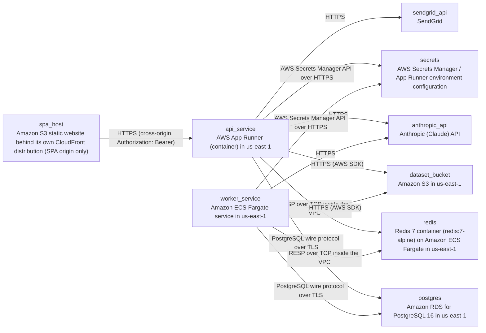

# Deployment Guide

> Maintained by QuorQ AI SDLC. Text between `sdlc:auto` markers is regenerated; anything outside them is yours and is kept.

<!-- sdlc:auto:start how-it-deploys -->
Pushes to `main` run `.github/workflows/deploy.yml`, which builds the API image (if there is a backend) and deploys the SPA to AWS Amplify. Commits touching only `docs/sdlc/**` don't deploy. Deployments can also be started from the platform's Deployment tab.
<!-- sdlc:auto:end how-it-deploys -->

<!-- sdlc:auto:start environments -->
| Name | Service | Runtime | Scaling | Environment |
|---|---|---|---|---|
| spa_host | Amazon S3 static website behind its own CloudFront distribution (SPA origin only) | React 19 production build, VITE_API_BASE_URL injected at build/deploy | CDN edge, no instance scaling | dev |
| api_service | AWS App Runner (container) in us-east-1 | FastAPI 0.115 on Python 3.12 behind Uvicorn, own HTTPS hostname separate from the SPA | 1 instance for the PoC, autoscale 1-2 | dev |
| worker_service | Amazon ECS Fargate service in us-east-1 | Same FastAPI 0.115 image run as an RQ worker for ingest, dedup, extraction, training and evaluation | 1 task, scaled manually for the ingest run | dev |
| postgres | Amazon RDS for PostgreSQL 16 in us-east-1 | PostgreSQL 16, app schema plus eval schema with a separate role, encrypted at rest with KMS, automated backups | Single-AZ db.t4g.medium with gp3 storage sized for ~572k events, 167k truth rows and 40k notes | dev |
| redis | Redis 7 container (redis:7-alpine) on Amazon ECS Fargate in us-east-1 | One Redis 7 instance serving the cache on db 0 and the job queue on db 1, reachable only inside the VPC | Single task | dev |
| dataset_bucket | Amazon S3 in us-east-1 | Private bucket for dataset v0.1 files including fhir/*.ndjson.gz, model artefacts and generated PDFs, SSE-KMS encryption, versioning on, public access blocked | Managed | dev |
| anthropic_api | Anthropic (Claude) API | SaaS over HTTPS, credential supplied as ANTHROPIC_API_KEY | Managed by provider | dev |
| sendgrid_api | SendGrid | SaaS over HTTPS, credential supplied as SENDGRID_API_KEY | Managed by provider | dev |
| secrets | AWS Secrets Manager / App Runner environment configuration | Holds <database-connection-string>, <anthropic-api-key>, <sendgrid-api-key> and the S3 credentials, injected as environment variables at start | Managed | dev |
<!-- sdlc:auto:end environments -->

<!-- sdlc:auto:start live -->
**Frontend URL:** https://p45a9603f83d5.d13el1ykvx8z63.amplifyapp.com

**Backend URL:** https://75-101-253-178.sslip.io/apps/45a9603f83d5/

**Database:** PostgreSQL · app

**Version:** 56874ef342c3

**Commit:** `56874ef`

**Finished:** 2026-11-14
<!-- sdlc:auto:end live -->

<!-- sdlc:auto:start topology -->

<!-- sdlc:auto:end topology -->
